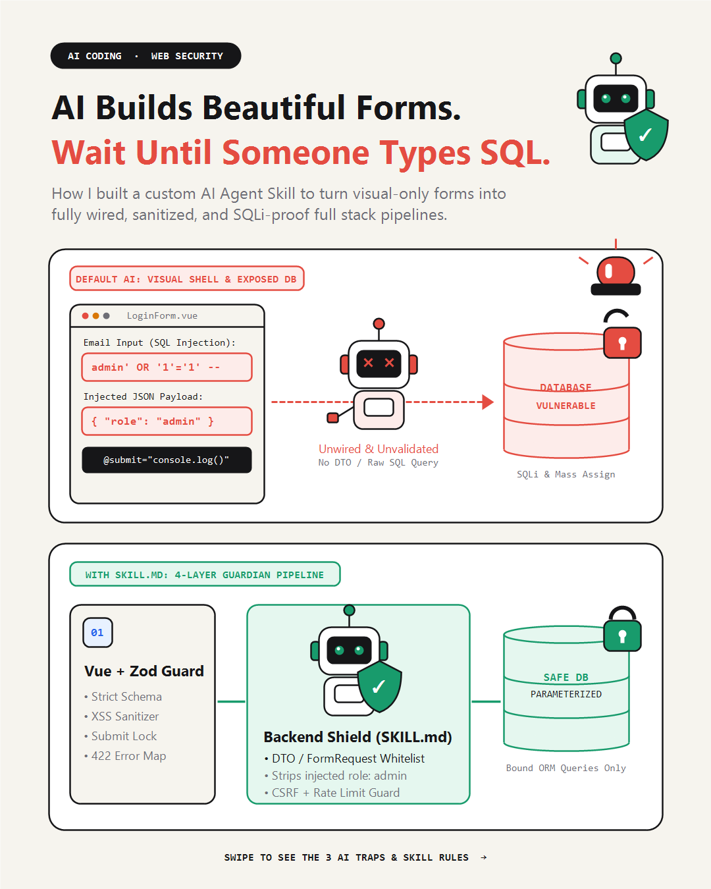
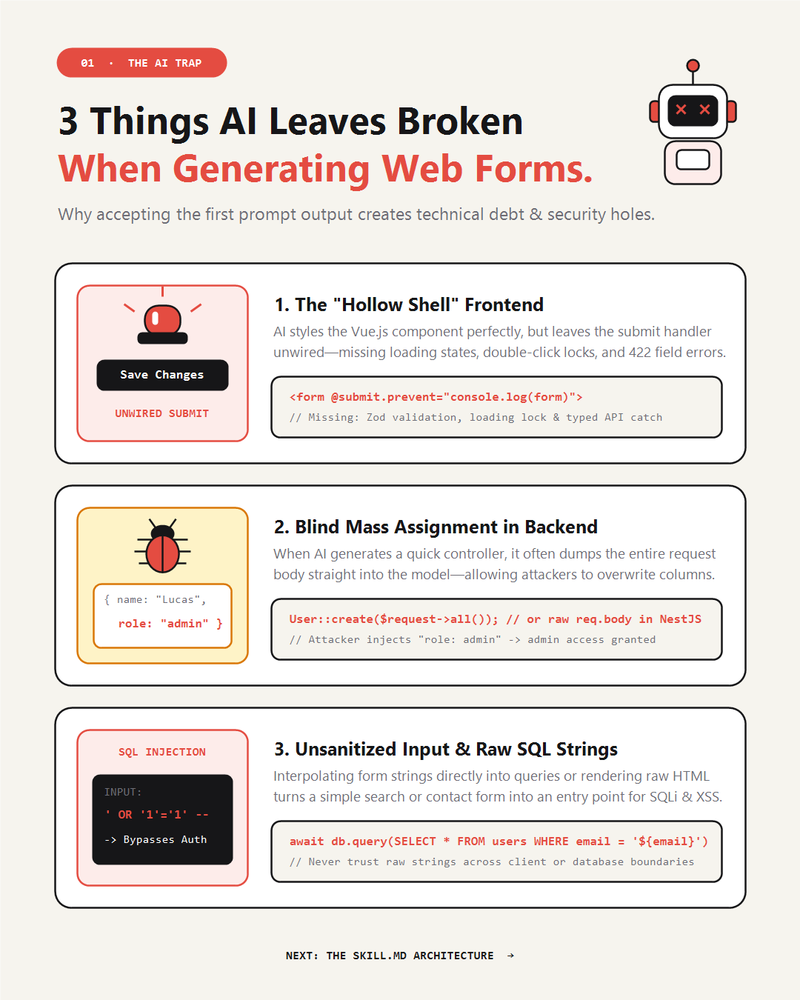
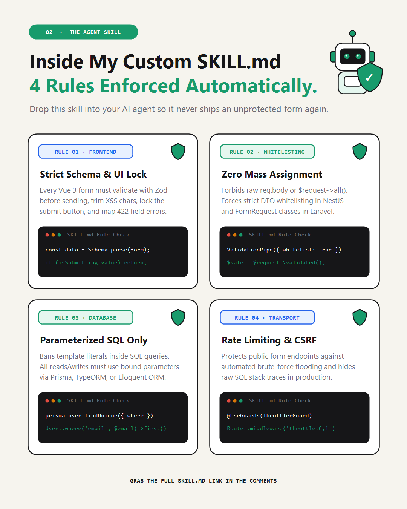

# 🛡️ Secure Full Stack Forms — AI Agent Skill (`SKILL.md`)

> **Stop shipping hollow, visual-only AI forms.**  
> A production-grade AI Agent Skill (for **Cursor, Claude Code, Antigravity, and Windsurf**) that enforces end-to-end form engineering, strict payload whitelisting, and **SQL Injection / XSS / Mass Assignment** protection across **Vue.js (TypeScript)** frontends and **NestJS / Laravel** backends.



---

## 🚨 The Problem: What Default AI Assistants Generate

When you ask an AI coding assistant to build a form, it optimizes for visual speed—often leaving critical engineering and security gaps:

1. **The "Hollow Shell" Frontend:** Styled inputs with an unwired `@submit.prevent="console.log(form)"`, missing loading locks, double-submit protection, and `422` field-level error mapping.
2. **Blind Mass Assignment:** Backend controllers that pass raw payloads straight into ORM models (`User::create($request->all())` or unvalidated `req.body`), allowing attackers to inject fields like `{ "role": "admin" }`.
3. **SQL Injection (SQLi) & XSS Risks:** Unsanitized strings or raw template literals interpolated directly inside database queries (`SELECT * FROM users WHERE email = '${email}'`).

---

## ✅ What This Skill Enforces Automatically

Once installed in your project, the agent is forbidden from marking any form feature complete until **all 4 security and architectural layers** are wired:

| Layer | Boundary | Enforced Engineering Contract |
| :--- | :--- | :--- |
| **01** | **Client Guard (Vue 3 + TS)** | Strict `Zod` / `Valibot` schema validation before HTTP calls, XSS input sanitization, `isSubmitting` race-condition lock, and `422` field error mapping. |
| **02** | **Payload Whitelisting** | **NestJS:** `ValidationPipe({ whitelist: true, forbidNonWhitelisted: true })` on every DTO.<br>**Laravel:** Dedicated `FormRequest` using `$request->validated()` only (`$request->all()` is strictly banned). |
| **03** | **Database Persistence** | Zero raw SQL string interpolation. Enforces bound parameters across **Prisma**, **TypeORM**, and **Eloquent ORM**. |
| **04** | **Transport & Abuse Guard** | Enforces CSRF verification, endpoint rate-limiting (`ThrottlerGuard` / `throttle:6,1`), and safe production error responses without stack-trace leaks. |

---

## 📸 Visual Architecture Breakdown

<p align="center">
  
  
</p>

---

## 🚀 Quick Installation

Drop the [`SKILL.md`](./SKILL.md) file into your project's AI agent skills directory:

```bash
# Clone the skill into your project's agent skills folder
mkdir -p .agents/skills/secure-fullstack-forms
curl -o .agents/skills/secure-fullstack-forms/SKILL.md https://raw.githubusercontent.com/LucasPivovar/secure-fullstack-forms-skill/main/SKILL.md
```

Or copy the contents of [`SKILL.md`](./SKILL.md) directly into:
- **Antigravity / Claude Code:** `.agents/skills/secure-fullstack-forms/SKILL.md`
- **Cursor Rules:** `.cursor/rules/secure-fullstack-forms.mdc`

---

## 👨‍💻 Author

**Lucas Pivovar** — Full Stack Developer (`Vue.js · TypeScript · Node.js · NestJS · Laravel`)
- 🔗 [LinkedIn](https://www.linkedin.com/in/lucas-pivovar-a25b71337/)
- 💻 [GitHub](https://github.com/LucasPivovar)
